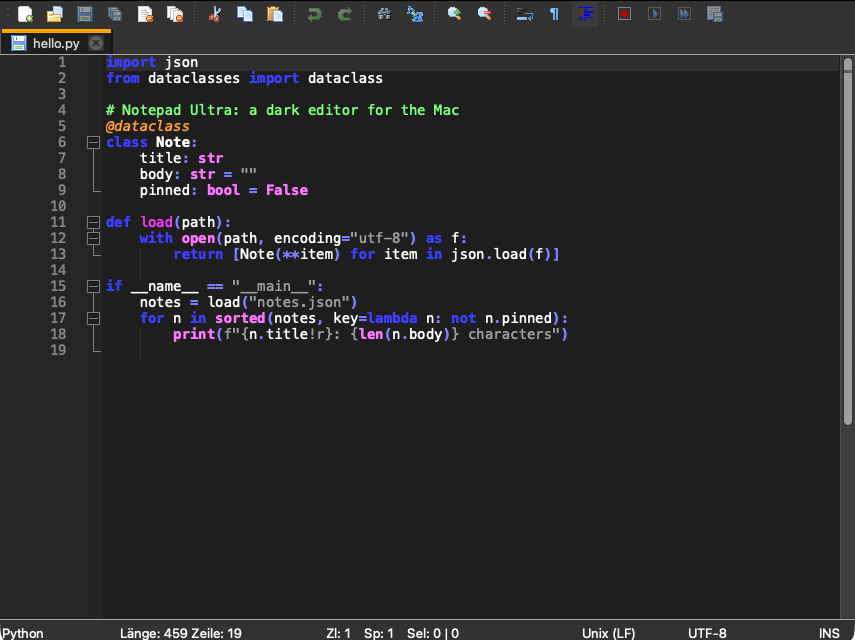
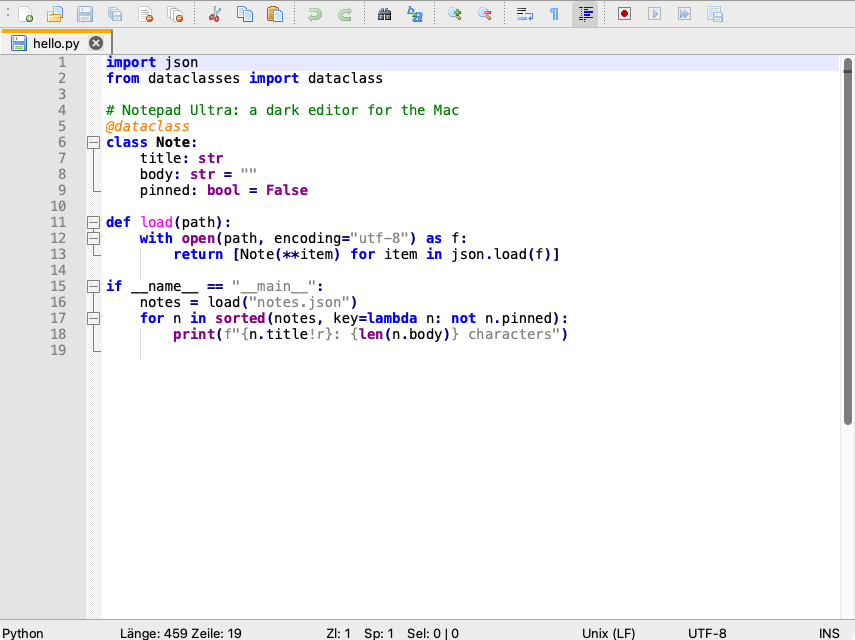

# Notepad Ultra

A fast, cross-platform text and code editor with syntax highlighting for 100+ languages, multi-cursor editing, a powerful search and replace, macros and a **dark mode**. Notepad Ultra is a fork of [Notepad Next](https://github.com/dail8859/NotepadNext) by Justin Dailey, which in turn is a reimplementation of Notepad++. It is developed with a focus on macOS.

| Dark | Light |
|---|---|
|  |  |

## What is different from Notepad Next

- **Dark mode.** *Preferences > Appearance* switches between System, Light and Dark. The editor, the language colors, the tabs and the window follow, live and without a restart. "System" follows the macOS appearance.
- **Startup text size fix on macOS** for windows opening on a non-Retina monitor (also sent upstream as [dail8859/NotepadNext#1192](https://github.com/dail8859/NotepadNext/pull/1192)).
- New name and icon.

## Download

Prebuilt macOS packages (Apple Silicon and Intel) are on the [Releases](../../releases) page. The app is not notarized by Apple, so on first start use right click > Open.

## Build

See [doc/Building.md](doc/Building.md). On macOS with Homebrew Qt 6:

```bash
brew install cmake qtbase qt5compat qtsvg qttools
cmake -S . -B build -DCMAKE_BUILD_TYPE=Release -DCMAKE_PREFIX_PATH="$(brew --prefix qtbase);$(brew --prefix qt5compat);$(brew --prefix qtsvg);$(brew --prefix qttools)"
cmake --build build -j
```

Dark mode uses `QStyleHints::setColorScheme()` from Qt 6.8. On older Qt versions a Fusion style with a dark palette is used instead.

## Credits and license

Notepad Ultra is based on [Notepad Next](https://github.com/dail8859/NotepadNext) by Justin Dailey and uses [Scintilla](https://www.scintilla.org/), [Lexilla](https://www.scintilla.org/Lexilla.html) and [Qt](https://www.qt.io/). It is licensed under the [GNU General Public License v3](LICENSE). The original README is kept in [doc/README-Notepad-Next.md](doc/README-Notepad-Next.md).
